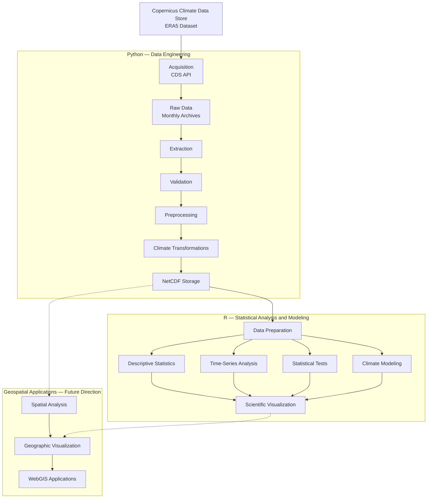
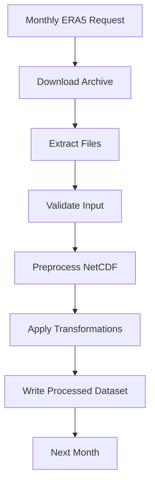
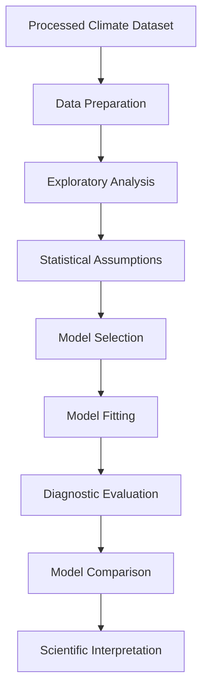
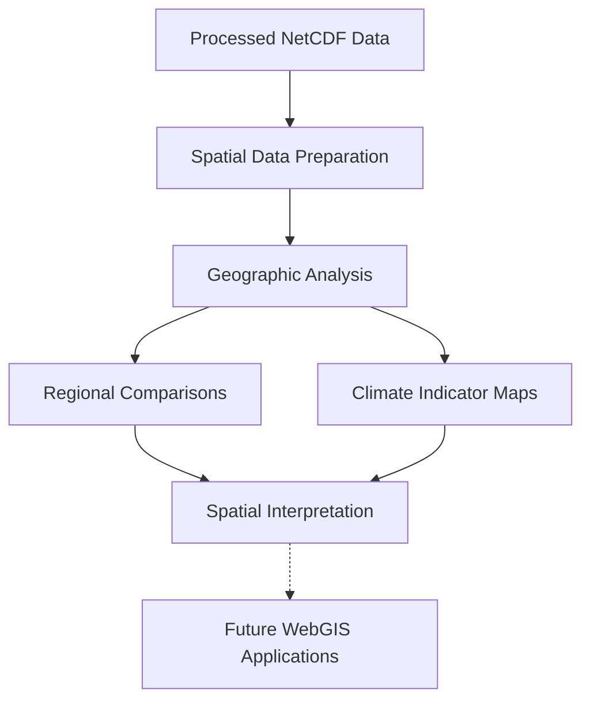

# ERA5 Tunisia Climate

### Geospatial Data Engineering · Statistical Analysis · Climate Modeling · Spatial Intelligence

<p align="center">
  <strong>From raw climate data to scientific and geospatial intelligence.</strong>
</p>

<p align="center">
  
  
  
  
  
  
</p>

---

## Overview

Climate data is inherently multidimensional. It describes environmental conditions across time, geographic space, and physical variables.

**ERA5 Tunisia Climate** is a climate data engineering and analysis project designed to transform historical climate reanalysis data into structured datasets for statistical investigation, climate modeling, and geospatial applications.

The project uses the ERA5 reanalysis dataset provided by the Copernicus Climate Change Service (C3S).

It combines two complementary technical environments:

- **Python** for climate data acquisition, engineering, validation, preprocessing, transformation, and storage.
- **R** for statistical analysis, time-series analysis, climate modeling, and scientific visualization.

The objective is not simply to download climate data. It is to establish a reproducible workflow that connects data engineering with scientific analysis and geographic interpretation.

The long-term vision is to build a foundation for climate intelligence applications and future WebGIS development.

---

## Table of Contents

- [Project Scope](#project-scope)
- [Data Foundation](#data-foundation)
- [System Architecture](#system-architecture)
- [Data Engineering Pipeline](#data-engineering-pipeline)
- [Climate Variables](#climate-variables)
- [Technology Stack](#technology-stack)
- [Engineering Principles](#engineering-principles)
- [Getting Started](#getting-started)
- [Configuration](#configuration)
- [Running the Pipeline](#running-the-pipeline)
- [Data Organization](#data-organization)
- [Statistical Analysis with R](#statistical-analysis-with-r)
- [Climate Modeling](#climate-modeling)
- [Spatial Analysis](#spatial-analysis)
- [Testing and Quality Assurance](#testing-and-quality-assurance)
- [Project Structure](#project-structure)
- [Project Status](#project-status)
- [Development Roadmap](#development-roadmap)
- [Scientific Considerations](#scientific-considerations)
- [Data Source and References](#data-source-and-references)
- [Author](#author)

---

## Project Scope

| Dimension | Description |
|---|---|
| Geographic area | Tunisia |
| Data source | Copernicus ERA5 |
| Dataset category | Single-level reanalysis |
| Temporal resolution | Hourly |
| Study period | 2000–2025 |
| Geographic representation | Latitude / longitude grid |
| Approximate latitude range | 30.25°N–37.50°N |
| Approximate longitude range | 7.50°E–11.50°E |
| Data format | NetCDF |
| Data engineering language | Python |
| Statistical analysis language | R |
| Main analytical direction | Climate statistics and modeling |
| Long-term direction | Geospatial applications and WebGIS |

The geographic extent and study period describe the project's configured study domain. Actual data availability depends on successful acquisition and the requested dates.

---

## Data Foundation

### ERA5 Reanalysis

The project uses ERA5, the fifth generation of atmospheric reanalysis produced by the European Centre for Medium-Range Weather Forecasts (ECMWF).

ERA5 combines numerical weather prediction models with observational data to provide a consistent representation of historical atmospheric conditions.

The project focuses on a selected geographic domain covering Tunisia instead of processing the entire global dataset.

### Selected Climate Variables

The initial dataset includes four ERA5 single-level variables.

| Variable | Description | Original Unit |
|---|---|---|
| `t2m` | 2-metre air temperature | K |
| `tp` | Total precipitation | m |
| `u10` | 10-metre eastward wind component | m/s |
| `v10` | 10-metre northward wind component | m/s |

### Derived Variables

The Python preprocessing stage generates additional climate variables.

| Derived Variable | Transformation | Output Unit |
|---|---|---|
| `temperature_celsius` | Kelvin to Celsius | °C |
| `precipitation_mm` | Metres to millimetres | mm |
| `wind_speed` | Wind vector magnitude | m/s |

The transformations are defined as follows.

**Temperature conversion**

\[
T_{^\circ C} = T_K - 273.15
\]

**Precipitation conversion**

\[
P_{mm} = P_m \times 1000
\]

**Wind speed magnitude**

\[
WS = \sqrt{u_{10}^{2} + v_{10}^{2}}
\]

These transformations provide a more convenient representation for subsequent scientific analysis.

They do not, by themselves, perform daily or monthly temporal aggregation.

---

## System Architecture

The project follows a modular, procedural architecture in Python, combined with a separate analytical environment in R.

The engineering pipeline is responsible for preparing reliable datasets. The analytical layer consumes those datasets to investigate climate behavior.

### High-Level Architecture



### Separation of Responsibilities

| Layer | Technology | Responsibility |
|---|---|---|
| Data acquisition | Python | Retrieve ERA5 data |
| Data engineering | Python | Extract, validate, and preprocess data |
| Data transformation | Python | Convert units and derive variables |
| Scientific storage | NetCDF | Preserve multidimensional datasets |
| Statistical analysis | R | Descriptive and inferential statistics |
| Time-series analysis | R | Temporal patterns, trends, and seasonality |
| Climate modeling | R | Statistical models and forecasting experiments |
| Scientific visualization | R | Statistical charts and analytical results |
| Spatial analysis | GIS / R / Python | Geographic interpretation and mapping |
| Geographic applications | WebGIS | Future interactive geographic services |

The analytical and geospatial layers are development objectives. They should not be interpreted as already implemented features.

---

## Data Engineering Pipeline

The Python pipeline is organized around monthly processing.

This approach avoids requiring the entire historical dataset to be downloaded and processed in one operation.

### Processing Workflow



### 1. Acquisition

The acquisition layer communicates with the Copernicus Climate Data Store API.

Its responsibility is to request the selected ERA5 variables, geographic domain, and temporal period.

### 2. Extraction

The extraction layer handles downloaded monthly archives and prepares their contents for processing.

### 3. Validation

The validation layer checks data integrity and expected processing conditions.

Its purpose is to detect unsuitable inputs before they enter subsequent processing stages.

### 4. Preprocessing

The preprocessing stage opens and prepares the NetCDF datasets.

It handles the preparation and integration of monthly climate data.

### 5. Transformations

The transformation stage derives convenient climate variables from the original ERA5 fields.

Examples include temperature conversion, precipitation unit conversion, and wind speed calculation.

### 6. Storage

Processed datasets are written in NetCDF format.

NetCDF preserves multidimensional scientific information, including variables, dimensions, coordinates, and metadata.

### 7. Orchestration

The pipeline coordinates the monthly execution of the processing stages.

Its responsibilities include:

- Managing the monthly workflow.
- Coordinating processing components.
- Handling processing results.
- Recording execution information.
- Supporting controlled reprocessing.

The current architecture uses sequential processing. It is not a distributed computing system.

---

## Climate Variables

The project initially focuses on four atmospheric variables.

### Temperature

The `t2m` variable represents air temperature at two metres above the surface.

It can support:

- Temperature distribution analysis.
- Seasonal comparisons.
- Monthly and annual climatologies.
- Temperature variability.
- Long-term temperature trend analysis.

### Precipitation

The `tp` variable represents total precipitation.

It can support:

- Rainfall distribution analysis.
- Seasonal precipitation comparisons.
- Dry and wet period identification.
- Precipitation variability.
- Statistical precipitation modeling.

Its accumulation convention must be considered before calculating hourly, daily, or monthly rainfall totals.

### Wind Components

The `u10` and `v10` variables represent horizontal wind components at ten metres above the surface.

Together, they provide information about wind direction and magnitude.

The derived `wind_speed` variable represents the magnitude of the horizontal wind vector.

---

## Technology Stack

The project combines scientific Python libraries with R statistical computing tools.

### Python — Data Engineering

| Technology | Role |
|---|---|
| Python 3.12 | Main engineering language |
| xarray | Multidimensional climate data processing |
| NumPy | Numerical computation |
| Pandas | Tabular and temporal data manipulation |
| NetCDF | Scientific data storage |
| CDS API | ERA5 data acquisition |
| PyYAML | Configuration management |
| pytest | Automated testing |

### R — Statistical Analysis and Modeling

| Technology | Role |
|---|---|
| R | Statistical computing |
| ggplot2 | Statistical visualization |
| forecast | Time-series analysis and forecasting |
| dplyr | Data manipulation |
| tidyr | Data organization |
| lubridate | Date and time operations |
| tseries | Time-series statistical tests |
| trend | Trend analysis methods |

The R packages listed here represent the intended analytical toolkit. Their integration and use will be documented as the analysis layer is implemented.

### Geospatial Technologies — Future Development

Potential technologies for future spatial applications include:

| Technology | Potential Role |
|---|---|
| QGIS | Geographic exploration and mapping |
| sf | Spatial data processing in R |
| terra | Raster and spatial analysis |
| GeoPandas | Geospatial processing in Python |
| PostGIS | Spatial database management |
| Leaflet | Interactive geographic visualization |

---

## Engineering Principles

The implementation is guided by the following principles.

**Separation of Concerns**

Acquisition, extraction, validation, preprocessing, transformation, storage, and analytics remain distinct responsibilities.

**Modularity**

Components are organized so that their behavior can be developed and tested independently.

**Sequential Processing**

Monthly execution helps control resource consumption and makes long-running workflows easier to monitor.

**Data Quality**

Validation is incorporated into the processing lifecycle to detect invalid inputs and processing problems.

**Controlled Reprocessing**

Existing outputs are handled through explicit processing and overwrite policies.

**Reproducibility**

Configuration-driven execution, structured logging, and automated tests support consistent processing behavior.

**Scientific Integrity**

Statistical analysis and climate modeling must document their assumptions, methods, parameters, and limitations.

**Maintainability**

The project favors readable functions, clear responsibilities, and a procedural design appropriate to its current scope.

---

## Getting Started

### Prerequisites

Before installing the project, make sure you have:

- Python 3.12.
- Git.
- A Copernicus Climate Data Store account.
- CDS API credentials configured locally.
- Sufficient disk space for downloaded and processed datasets.

R is required for the statistical analysis and modeling stages. It is not required to execute the Python acquisition pipeline.

Actual storage requirements depend on the requested period, geographic resolution, variables, and intermediate files.

### 1. Clone the Repository

```bash
git clone https://github.com/El-Barre-Ahmed/era5-tunisia-climate.git

cd era5-tunisia-climate
```

### 2. Create a Python Virtual Environment

```bash
python3.12 -m venv .venv
```

Activate the environment:

```bash
source .venv/bin/activate
```

### 3. Install Dependencies

Upgrade pip:

```bash
python -m pip install --upgrade pip
```

Install the project and its declared dependencies:

```bash
python -m pip install -e .
```

### 4. Verify the Installation

```bash
python --version
```

Display the available commands:

```bash
python main.py --help
```

### 5. Prepare R

Install R from the official R project distribution.

Then open R or RStudio and install the packages required for the planned analytical workflow.

For example:

```r
install.packages(c(
  "ggplot2",
  "dplyr",
  "tidyr",
  "lubridate",
  "forecast",
  "tseries",
  "trend"
))
```

These packages prepare the R environment; they do not mean that all analytical modules are already implemented.

---

## Configuration

Project configuration is maintained separately from the processing logic.

The main configuration file is:

```text
config/config.yaml
```

Review the configuration before starting a large acquisition or processing operation.

### CDS API Configuration

ERA5 acquisition requires valid Copernicus Climate Data Store API credentials.

1. Create or access a CDS account.
2. Follow the current CDS API setup instructions.
3. Configure your credentials locally.
4. Verify that your account has access to the required dataset.

Official documentation:

https://cds.climate.copernicus.eu/how-to-api

**Security requirements:**

- Never commit API credentials.
- Never publish access tokens.
- Keep private configuration outside version control.
- Do not include credentials in logs or screenshots.

---

## Running the Pipeline

The main command-line interface is provided through `main.py`.

### Display Available Commands

```bash
python main.py --help
```

### Display Pipeline Options

```bash
python main.py run --help
```

### Process a Single Month

```bash
python main.py run --start 2001-01 --end 2001-01
```

### Process Three Years

```bash
python main.py run --start 2001-01 --end 2003-12
```

The pipeline processes the requested period month by month.

### Execution Considerations

A multi-year execution can take considerable time because it involves:

- Remote data requests.
- CDS request queues.
- Data downloads.
- Archive extraction.
- Validation.
- NetCDF processing.
- Local storage operations.

Do not start a second execution for the same period without first checking the status of the existing process and its CDS requests.

For the exact supported options and behavior, consult:

```bash
python main.py run --help
```

---

## Data Organization

The project separates source data, intermediate files, and processed outputs.

The conceptual data lifecycle follows this organization:

```text
data/
│
├── raw/
│   └── Original downloaded monthly archives
│
├── intermediate/
│   └── Extracted and prepared monthly datasets
│
└── processed/
    └── Final processed NetCDF datasets
```

The exact filenames and subdirectory organization are controlled by the project configuration and processing implementation.

### Raw Data

Contains the original downloaded source archives.

These files represent the acquisition stage and should remain distinguishable from transformed outputs.

### Intermediate Data

Contains files prepared during extraction and preprocessing.

These files support the transition from downloaded archives to processed datasets.

### Processed Data

Contains the resulting NetCDF datasets with the selected and derived climate variables.

These datasets are intended to serve as the input for subsequent statistical and spatial analysis.

---

## Statistical Analysis with R

The project uses R as its primary environment for statistical investigation and scientific interpretation.

Python prepares the climate datasets. R is responsible for exploring their statistical properties and investigating temporal behavior.

### 1. Descriptive Climate Statistics

The first analytical stage focuses on understanding the structure and distribution of the climate variables.

Planned analyses include:

- Mean, median, minimum, and maximum.
- Standard deviation and variance.
- Quantiles and distribution analysis.
- Monthly and annual climatologies.
- Seasonal comparisons.
- Temperature and precipitation variability.
- Wind speed distributions.

### 2. Time-Series Analysis

Climate variables are observed over time. Their temporal structure must be understood before building statistical models.

Planned methods include:

- Time-series visualization.
- Moving averages.
- Smoothing methods.
- Trend and seasonality analysis.
- Time-series decomposition.
- Autocorrelation function (ACF).
- Partial autocorrelation function (PACF).
- Stationarity assessment.

### 3. Statistical Analysis

The statistical analysis stage investigates relationships and patterns in the climate variables.

Planned methods include:

- Correlation analysis.
- Linear regression.
- Multiple regression.
- Statistical hypothesis testing.
- Confidence intervals.
- Mann–Kendall trend tests.
- Sen's slope estimation.

### 4. Scientific Visualization

R will be used to produce scientific visualizations that communicate analytical results.

Examples include:

- Temperature evolution charts.
- Precipitation distributions.
- Seasonal comparison plots.
- Climate anomaly visualizations.
- Trend visualizations.
- Statistical diagnostic plots.

The main visualization framework planned for this stage is `ggplot2`.

---

## Climate Modeling

Beyond descriptive statistics, the project aims to investigate statistical models capable of representing climate behavior.

Modeling will be developed as a distinct analytical stage, supported by documented assumptions and evaluation procedures.

### Modeling Objectives

**Temperature Modeling**

Investigate temporal patterns and statistical relationships in temperature observations.

**Precipitation Modeling**

Explore precipitation variability, seasonal behavior, and statistical distributions.

**Time-Series Forecasting**

Evaluate forecasting methods for selected climate variables.

**Model Evaluation**

Compare models using appropriate evaluation criteria and diagnostic procedures.

### Modeling Workflow



### Model Evaluation

Model evaluation should consider:

- Residual behavior.
- Model assumptions.
- Prediction errors.
- Temporal validation.
- Overfitting risk.
- Comparison with baseline models.

Forecasting methods will be selected according to the properties of each climate time series.

The use of a forecasting model does not automatically make it a climate projection model. Predictions over a historical time series and future climate projections are different scientific tasks.

---

## Spatial Analysis

Climate behavior is not uniform across geographic space.

A national average can hide substantial differences between coastal, northern, central, and southern regions.

The future spatial analysis stage will preserve the geographic dimensions of the ERA5 datasets.

### Planned Spatial Analysis

- Geographic temperature distributions.
- Precipitation distribution maps.
- Regional climate comparisons.
- Spatial variability.
- Geographic identification of climate patterns.
- Spatial visualization of statistical indicators.

### Potential Geospatial Workflow



Potential future technologies include QGIS, R `sf`, `terra`, Python GeoPandas, and PostGIS.

---

## Testing and Quality Assurance

Automated unit tests are used to verify the behavior of the Python components.

Run the unit test suite:

```bash
python -m pytest tests/unit -q
```

The latest reported local test result during development was:

```text
57 passed
```

This result refers to the unit tests executed at that development stage. It is not a claim that every possible integration scenario or real CDS acquisition has been tested.

### Testing Scope

The unit tests focus on component behavior, including:

- Acquisition logic.
- Extraction behavior.
- Validation rules.
- Preprocessing behavior.
- Pipeline orchestration.
- Command-line interface behavior.

Real data acquisition and long-running end-to-end executions require separate operational verification.

The future R analytical layer will also require its own validation procedures, including statistical diagnostics, model evaluation, and reproducibility checks.

---

## Project Structure

The main Python source-code organization is:

```text
era5-tunisia-climate/
│
├── config/
│   └── config.yaml
│
├── data/
│   ├── raw/
│   ├── intermediate/
│   └── processed/
│
├── src/
│   └── era5_tunisia/
│       ├── acquisition/
│       │   ├── cds_client.py
│       │   └── downloader.py
│       │
│       ├── extraction/
│       │   └── extractor.py
│       │
│       ├── processing/
│       │   ├── preprocessor.py
│       │   └── transformations.py
│       │
│       ├── storage/
│       │   └── netcdf_writer.py
│       │
│       ├── validation/
│       │   └── validator.py
│       │
│       ├── utils/
│       │
│       ├── config.py
│       ├── logging_config.py
│       └── pipeline.py
│
├── tests/
│   └── unit/
│
├── main.py
├── pyproject.toml
└── README.md
```

The R analysis directory and its scripts will be introduced as the analytical layer is developed. They are not represented here as existing modules.

---

## Project Status

The following table distinguishes implemented engineering capabilities from planned scientific work.

| Component | Status |
|---|---|
| ERA5 data acquisition | Implemented |
| Monthly archive handling | Implemented |
| Data extraction | Implemented |
| Data validation | Implemented |
| NetCDF preprocessing | Implemented |
| Climate variable transformations | Implemented |
| Processed NetCDF storage | Implemented |
| Monthly pipeline orchestration | Implemented |
| Command-line interface | Implemented |
| Python unit testing | Implemented |
| R analytical environment | Development direction |
| Descriptive climate statistics | Planned |
| Time-series analysis | Planned |
| Statistical hypothesis testing | Planned |
| Climate trend analysis | Planned |
| Statistical climate modeling | Planned |
| Forecasting experiments | Planned |
| Spatial climate analysis | Planned |
| WebGIS application | Future direction |
| GeoAI and machine learning | Future direction |

---

## Development Roadmap

### Phase 1 — Data Engineering Foundation

- [x] Modular Python architecture.
- [x] ERA5 acquisition workflow.
- [x] Monthly processing pipeline.
- [x] Data validation.
- [x] Climate variable transformations.
- [x] NetCDF output generation.
- [x] Command-line execution.
- [x] Python unit testing.

### Phase 2 — Statistical Analysis with R

- [ ] R analytical project structure.
- [ ] NetCDF data integration.
- [ ] Data preparation and quality assessment.
- [ ] Descriptive climate statistics.
- [ ] Monthly and annual climatologies.
- [ ] Seasonal analysis.
- [ ] Statistical visualization.
- [ ] Correlation analysis.

### Phase 3 — Time-Series Analysis

- [ ] Time-series construction.
- [ ] Moving averages and smoothing.
- [ ] Trend and seasonality analysis.
- [ ] Time-series decomposition.
- [ ] ACF and PACF analysis.
- [ ] Stationarity assessment.
- [ ] Climate anomaly analysis.

### Phase 4 — Statistical Modeling

- [ ] Regression analysis.
- [ ] Statistical hypothesis testing.
- [ ] Mann–Kendall trend tests.
- [ ] Sen's slope estimation.
- [ ] Temperature modeling.
- [ ] Precipitation modeling.
- [ ] Forecasting experiments.
- [ ] Model diagnostics and comparison.

### Phase 5 — Spatial Intelligence

- [ ] Spatial data preparation.
- [ ] Geographic climate distributions.
- [ ] Temperature and precipitation mapping.
- [ ] Regional comparisons.
- [ ] Spatial variability analysis.
- [ ] Geographic visualization.

### Phase 6 — Geospatial Applications

- [ ] Spatial database integration.
- [ ] WebGIS development.
- [ ] Interactive climate maps.
- [ ] Geographic data services.
- [ ] GeoAI experiments.

---

## Scientific Considerations

Climate data processing requires more than technically successful file conversion.

Scientific interpretation must account for the characteristics of the original dataset and the assumptions behind each analytical method.

### Precipitation Accumulation

ERA5 total precipitation is an accumulated variable.

Its temporal interpretation must be checked against the dataset's accumulation conventions before calculating hourly, daily, or monthly rainfall totals.

Converting metres to millimetres is a unit conversion, not a temporal aggregation.

### Climate Anomalies

An anomaly requires a clearly defined reference period.

The selected baseline, temporal grouping, and calculation method must be documented.

### Climate Trends

A trend estimated from a historical time series does not, by itself, establish the cause of the observed change.

Statistical significance and scientific interpretation must be considered separately.

### Temporal Dependence

Climate observations are often temporally dependent.

Statistical tests and modeling methods must account for seasonality, autocorrelation, and other relevant properties of the time series.

### Spatial Representation

A geographic average can hide important regional differences.

Spatial analysis should preserve latitude and longitude dimensions whenever geographic variability is relevant.

### Model Validation

Forecasting models must be evaluated using appropriate validation strategies.

Randomly splitting temporally ordered observations can introduce information leakage. Time-aware validation is therefore important.

---

## Data Source and References

Climate data used in this project originates from the Copernicus Climate Change Service (C3S).

The service is implemented by the European Centre for Medium-Range Weather Forecasts (ECMWF).

Official references:

- [Copernicus Climate Data Store](https://cds.climate.copernicus.eu/)
- [CDS API Documentation](https://cds.climate.copernicus.eu/how-to-api)
- [ERA5 Single Levels Dataset](https://cds.climate.copernicus.eu/datasets/reanalysis-era5-single-levels)
- [ECMWF](https://www.ecmwf.int/)
- [R Project](https://www.r-project.org/)
- [xarray Documentation](https://docs.xarray.dev/)
- [NetCDF Documentation](https://www.unidata.ucar.edu/software/netcdf/)

Users should consult the applicable dataset licence, terms of use, and attribution requirements before redistributing source or derived data.

---

## Author

**El-Barre Ahmed**

Data Engineering · Data Science · Statistical Computing · Geospatial Technologies

GitHub: [@El-Barre-Ahmed](https://github.com/El-Barre-Ahmed)

---

<p align="center">
  <strong>From climate data engineering to scientific and spatial intelligence.</strong>
  <br>
  Building a bridge between data infrastructure, statistical modeling, and geographic understanding.
</p>
